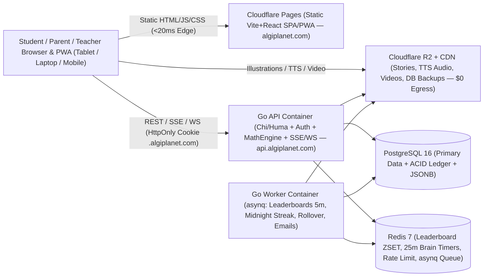

# 08 — Technical Architecture, Database Schema, API Contracts & Deployment

> **Owner Tracks**: `INFRA`, `DB`, `BE`, `FE`, `QA`  
> **Scope**: Polyglot monorepo layout (**Static Vite + React PWA** on **Cloudflare Pages** + **Go API/Workers** via **Docker/Coolify**), full PostgreSQL (`sqlc`/`goose`) data model, Redis real-time patterns, OpenAPI 3.1 contract sync, deployment topology, PWA caching, and CI/CD.

---

## 1. System Architecture & Monorepo Layout

AlgiPlanet combines a **static edge-deployed React SPA/PWA** (zero frontend server cost, sub-20ms edge loads across Indonesia & SEA via **Cloudflare Pages**) with a **high-concurrency Golang backend** (REST API + SSE/WebSocket + `asynq` Redis workers + authoritative Math Engine) running in lightweight Docker containers.

```text
algiplanet/
├── apps/
│   ├── web/                     # Vite + React 19 + TypeScript + TanStack Router + Tailwind + i18next + vite-plugin-pwa (Static → Cloudflare Pages)
│   └── api/                     # Go 1.23+ (Chi + Huma OpenAPI 3.1 + pgx/v5 + sqlc + goose + go-redis + asynq)
│       ├── cmd/
│       │   ├── server/          # HTTP API + SSE/WebSocket binary
│       │   ├── worker/          # asynq background workers & cron scheduler binary
│       │   └── seed/            # Curriculum, demo users & bilingual content seeder CLI
│       ├── db/
│       │   ├── migrations/      # Timestamped goose SQL migrations
│       │   └── queries/         # Type-safe sqlc SQL query files
│       └── internal/
│           ├── db/              # sqlc generated Go database layer
│           ├── mathengine/      # Server-authoritative Procedural Generator, Grader & TTS Verbalizer
│           ├── platform/        # Auth/JWT/OTP, TimeWindowService, Economy Ledger, R2 client, Logging
│           └── modules/         # Isolated per-feature packages (daily_orbit, streak, training, academy, stories, social, brain_galaxy, ...)
├── packages/
│   ├── api-client/              # Auto-generated TypeScript types & typed fetch client from Go OpenAPI 3.1 (`openapi-typescript`)
│   ├── ui/                      # AlgiPlanet Galaxy Design System components (Radix UI + Tailwind)
│   ├── i18n/                    # Namespaced EN/ID locale JSONs + CI key parity checker
│   ├── brain-games/             # 5-Zone HTML5 Canvas/SVG cognitive mini-games bundle
│   └── config/                  # Shared ESLint, Prettier, TypeScript configs
├── content/                     # Version-controlled JSON/YAML seeds (curricula, questions, stories, badges, super-sight)
├── tests/                       # Playwright E2E, k6 load tests, security test suites
└── docker/                      # Local dev Docker Compose (PostgreSQL 16, Redis 7, MinIO S3) + Production Dockerfiles
```

### High-Level Component & Deployment Diagram


---

## 2. Locked Production Tech Stack

| Layer | Technology | Rationale |
|---|---|---|
| **Frontend / Static PWA** | **Vite + React 19 + TypeScript + TanStack Router + Tailwind CSS + Radix UI + `vite-plugin-pwa`** | Ultra-fast builds, clean SPA dynamic routes on Cloudflare Pages, native PWA offline shell, tiny mobile bundles |
| **Frontend i18n** | **`i18next` + `react-i18next`** (`en` & `id` namespaced JSONs) | Zero-SSR-friction static localization, ICU plurals, conflict-free per-feature locale files |
| **State & Data Fetching** | **TanStack Query + Zustand** | Optimistic UI for Question Player & 4 Math Tools, instant SP/AC cache invalidation |
| **Math Rendering & Games** | **KaTeX + Custom Interactive SVG + HTML5 Canvas** | Instant fraction/equation rendering, Bar Model Builder, stylus Sketchpad, 60fps Brain Galaxy mini-games |
| **API Contract Sync** | **OpenAPI 3.1 (Huma in Go) → `openapi-typescript`** (`packages/api-client/`) | Single source of truth between Go backend and React frontend; zero manual DTO drift across parallel agents |
| **Backend API & Math Engine** | **Go 1.23+ (Chi + Huma)** + `internal/mathengine/` | ~40 MB RAM footprint, handles 5,000+ CCU on a single VPS, server-authoritative grading & question generation |
| **Database & Migrations** | **PostgreSQL 16 + `pgx/v5` + `sqlc` + `goose`** | Pure SQL migrations, compile-time type-safe queries, rock-solid ACID `SELECT ... FOR UPDATE` coin ledgers |
| **Cache, Queues & Rankings** | **Redis 7 + `go-redis/v9` + `asynq`** | Sub-50ms Sorted Set leaderboards, 25-min Brain Galaxy timers, 5-min refresh jobs, midnight streak cron |
| **Real-Time** | **Server-Sent Events (SSE) / `coder/websocket`** | Live login SP ticker, incoming Star Duels, and notification bell updates |
| **Media & Storage** | **Cloudflare R2 + Cloudflare CDN** | `$0` egress fees for 20-page Planet Stories, cached neural TTS MP3s, videos, and daily DB backups |
| **Payments (Phase 5 Deferred)** | **Midtrans / Xendit (IDR)** + **Stripe (Global USD)** | Indonesian QRIS/VA/e-Wallet + global cards, gated behind `BILLING_ENABLED=false` during Phases 0–4 |
| **Testing & CI/CD** | **`go test` + Vitest + Playwright + k6 + GitHub Actions** | Fast Go/TS CI checks, bilingual E2E across mobile/tablet/desktop, 5,000-CCU load testing |

---

## 3. Core PostgreSQL Database Schema (`apps/api/db/migrations/`)

Managed via timestamped **`goose` SQL migrations** with type-safe Go queries generated by **`sqlc`**.

### 3.1 Identity, Schools & Subscriptions
- `user_accounts` (`id`, `role: PARENT|TEACHER|SCHOOL_ADMIN|ADMIN|CONTENT_EDITOR`, `email`, `phone`, `password_hash`, `otp_enabled`, `preferred_locale`, `timezone`, `created_at`)
- `schools` (`id`, `name`, `country_code`, `academic_rollover_month`, `academic_rollover_day`, `license_seats`, `active_until`)
- `classrooms` (`id`, `school_id`, `teacher_id`, `name`, `grade`, `academic_year`, `leaderboard_enabled`)
- `student_profiles` (`id`, `parent_account_id`, `school_id?`, `classroom_id?`, `login_id` UNIQUE, `password_hash`, `first_name`, `masked_display_name`, `grade` [1..6], `birthday?`, `gender?`, `preferred_locale`, `timezone`, `avatar_pack_id`, `avatar_item_id`, `astro_buddy_config` JSONB, `astro_buddy_name`, `crew_code` UNIQUE 9-digit, `daily_orbit_tier` [ELEMENTARY|INTERMEDIATE|ADVANCED|MASTER], `active_daily_curricula_by_subject` JSONB, `active_duel_curricula_by_subject` JSONB, `brain_galaxy_daily_cap_sec` DEFAULT 1500, `brain_galaxy_window_start`, `brain_galaxy_window_end`, `next_promotion_date`)
- `subscriptions` (`id`, `owner_type: FAMILY|SCHOOL`, `owner_id`, `plan_code`, `status`, `provider`, `external_id`, `current_period_start`, `current_period_end`)

### 3.2 Subjects, Curriculum, Questions & Attempts (Multi-Subject Ready)
> **Multi-Subject Extensibility**: Launch ships with `math` (`is_active = true`) while all curriculum, daily challenge, streak, academy, quiz, story, duel, leaderboard, and brain-game tables are scoped by `subject_id` so adding `science`, `english`, or other subjects later requires **zero breaking schema migrations**.
- `subjects` (`id`, `code` UNIQUE [`math`, `science`, `english`, ...], `translations` JSONB, `is_active` [only `math` active at launch], `sort_order`)
- `curricula` (`id`, `subject_id`, `code`, `translations` JSONB, `sort_order`, `is_active`)
- `topics` (`id`, `curriculum_id`, `grade`, `category: CORE|WORD_PROBLEM|CHALLENGING|HOTS|EXPLORER`, `translations` JSONB, `sort_order`)
- `skills` (`id`, `canonical_code`, `topic_id`, `difficulty` [1..5], `heuristic_code?`, `age_band?`, `video_tutorial_urls` JSONB, `translations` JSONB)
- `questions` (`id`, `code` UNIQUE, `subject_id`, `skill_id`, `kind: STATIC|PROCEDURAL`, `grade`, `difficulty` [1..5], `input_type`, `heuristic_code?`, `template_config` JSONB, `translations` JSONB, `media` JSONB, `grading_rule` JSONB, `status: DRAFT|IN_REVIEW|PUBLISHED|ARCHIVED`, `version`)
- `question_attempts` (`id`, `student_id`, `subject_id`, `question_id`, `question_seed?`, `skill_id`, `mode: DAILY_ORBIT|GALAXY_TRAINING|SPACE_ACADEMY|ASTRO_QUIZ|ASSIGNMENT|STAR_DUEL|SUNDAY_METEOR`, `session_id`, `submitted_answer` JSONB, `is_correct`, `is_skipped`, `is_first_check`, `time_spent_ms`, `created_at`)
- `student_skill_stats` (`student_id`, `skill_id`, `recent_window_count`, `recent_correct_count`, `proficiency_pct`, `proficiency_tier`, `best_session_score` [0..10], `best_stars` [0..3], `updated_at`)

### 3.3 Daily Orbit, Streaks, Academy, Quizzes & Assignments
- `daily_orbit_sessions` (`id`, `student_id`, `subject_id`, `local_date` DATE, `tier`, `questions_json` JSONB [10 slots with status/points], `change_question_used` [0..3], `correct_count`, `total_sp_earned`, `completed_at?`) — UNIQUE `(student_id, subject_id, local_date)`
- `student_streaks` (`student_id`, `subject_id`, `current_streak`, `longest_streak`, `cryo_shields` [0..3], `nova_pet_stage`, `last_completed_local_date`, `reminder_enabled`, `push_subscription` JSONB) — PK `(student_id, subject_id)`
- `streak_calendar_days` (`student_id`, `subject_id`, `local_date`, `status: COMPLETED|FROZEN|MISSED`) — UNIQUE `(student_id, subject_id, local_date)`
- `academy_topics` (`id`, `subject_id`, `grade`, ...), `academy_lessons` (`topic_id`, `age_band`, `story_video_urls` JSONB, `concept_video_urls` JSONB, `do_and_learn_question_ids` TEXT[], `self_check_items` JSONB)
- `academy_lesson_progress` (`student_id`, `lesson_id`, `stage_states` JSONB, `saved_draft_answers` JSONB, `star_scrolls_earned`, `completion_pct`)
- `astro_quiz_papers` (`id`, `subject_id`, `category: ESSENTIAL|TOP_SCHOOL|HOTS`, `grade`, `code`, `question_ids` TEXT[], `translations` JSONB)
- `astro_quiz_attempts` (`id`, `student_id`, `paper_id`, `status: IN_PROGRESS|SUBMITTED`, `elapsed_sec`, `draft_answers` JSONB, `score`, `submitted_at`, `supply_pod_week_key?`)
- `assignments` (`id`, `subject_id`, `assigned_by_role: SYSTEM|PARENT|TEACHER`, `assigned_by_id`, `title`, `question_ids` TEXT[], `due_date`, `academic_year`, `reward_ac`)
- `student_assignments` (`assignment_id`, `student_id`, `status: INCOMPLETE|COMPLETE`, `progress_count`, `score`, `completed_at`)

### 3.4 Economy, Stories, Badges, Social, Super Nova & Brain Galaxy
- `student_wallets` (`student_id` PK, `total_sp`, `astro_coins`, `pilot_xp`, `pilot_level` [1..100], `total_star_scrolls`, `updated_at`)
- `currency_transactions` (`id`, `student_id`, `subject_id?`, `currency: SP|AC|XP|SCROLL|S_PTS`, `delta`, `balance_after`, `source_type`, `source_id`, `idempotency_key` UNIQUE, `created_at`)
- `story_planets` (`id`, `subject_id`, `grade`, `code`, `translations` JSONB), `story_chapters` (`id`, `planet_id`, `chapter_index`, `unlock_cost_ac`, `pages_json` JSONB), `student_story_unlocks` (`student_id`, `chapter_id`, `last_page_read`)
- `daily_badge_templates` (`day_of_year` [1..366], `translations` JSONB, `artwork_url`), `student_daily_badges` (`student_id`, `local_date`, `tier` [1..4], `unlocked_via_ac`)
- `star_crews` (`id`, `name`, `created_by_student_id`), `star_crew_members` (`crew_id`, `student_id`, `joined_at`)
- `star_duels` (`id`, `subject_id`, `challenger_id`, `opponent_id`, `match_type: CLASSMATE|CREW|RANDOM`, `grade`, `question_ids` JSONB, `challenger_score`, `opponent_score`, `status`, `local_date`, `created_at`)
- `super_nova_attempts` (`id`, `student_id`, `subject_id`, `mode: SUPER_SIGHT|SUPER_WARP`, `is_practice`, `score`, `week_key`, `metadata` JSONB, `created_at`)
- `brain_galaxy_sessions` (`id`, `student_id`, `subject_id`, `zone`, `game_code`, `local_date`, `seconds_played`, `high_score`, `entry_paid_ac`, `started_at`, `ended_at`)
- `question_feedback` (`id`, `student_id`, `question_id`, `seed?`, `locale`, `category`, `message`, `status: OPEN|FIXED|DISMISSED`, `created_at`)
- `audit_logs` (`id`, `actor_id`, `actor_role`, `action`, `entity_type`, `entity_id`, `diff_json` JSONB, `created_at`)

---

## 4. API Design, Cookie Auth & Real-Time Patterns (`/api/v1/*`)

- **Conventions**: Versioned REST JSON (`/api/v1/...`), RFC 9457 / standardized error envelope `{ code, messageKey, details }`, cursor pagination on lists, OpenAPI 3.1 auto-exported from Go (`Huma`) → `packages/api-client/`.
- **Same-Root-Domain Auth**:
  - Frontend: `https://algiplanet.com` (Cloudflare Pages)
  - Backend API: `https://api.algiplanet.com` (Go API)
  - Auth uses **`HttpOnly; Secure; SameSite=Lax; Domain=.algiplanet.com`** cookies + CSRF double-submit/Origin validation — eliminating `localStorage` token XSS exposure cleanly across static frontend & Go backend.
- **Key Route Groups**:
  - `/auth/*` — login, refresh, logout, OTP request/verify
  - `/dashboard` — single aggregated bootstrap payload (profile, wallet, streak, active notifications count, pillar summaries)
  - `/daily-orbit/*` — `GET /today`, `POST /submit`, `POST /skip`, `POST /change-question`, `PATCH /tier`, `PATCH /curricula`
  - `/streak/*` — `GET /status`, `GET /calendar`, `POST /reminder`
  - `/training/*` — curricula, topics, skills (high-score + proficiency), HOTS wheel, practice sessions
  - `/academy/*` — topics, lessons, `POST /do-learn/save`, `POST /do-learn/check`, `PATCH /self-check`
  - `/astro-quiz/*` — papers, start/save/submit, `GET /:id/print`
  - `/assignments/*` — student list, parent builder endpoints
  - `/stories/*` — planets, chapters, `POST /chapters/:id/unlock`, progress bookmark
  - `/super-nova/*`, `/star-duels/*`, `/star-crew/*`, `/leaderboard/*`, `/events/*`, `/achievement/daily-badges/*`, `/astro-buddy/*`, `/showcase/*`, `/brain-galaxy/*`
  - `/reports/*` — proficiency & high-score reports
  - `/parent/*`, `/teacher/*`, `/admin/*`, `/billing/*`, `/tts/*`
- **Redis Leaderboard Key Pattern**:
  - `lb:{subjectCode}:{challengeType}:{periodKey}:{scope}:{scopeId}:{grade}` → Redis `ZSET` (`member = studentId`, `score = points`)
  - Refreshed every 5 minutes by Go `asynq` periodic worker + instant delta increment for student's own rank display.

---

## 5. Deployment Topology & Infrastructure Strategy

### Primary Target (Phase 0–4 — Lean, Ultra-Fast, Zero Lock-In)
| Component | Hosting Target | Region & Cost Profile |
|---|---|---|
| **Static Frontend & PWA (`apps/web`)** | **Cloudflare Pages** (`algiplanet.com`) | Global Edge incl. Jakarta & Singapore PoPs — **`$0`/mo**, unlimited bandwidth, `_redirects` SPA fallback, build-time prerendered `/en` & `/id` marketing routes |
| **Go API + Go `asynq` Worker + PostgreSQL 16 + Redis 7** | **VPS + Coolify (Docker Compose)** *(or **Railway / Fly.io** if preferring zero-VPS managed PaaS)* | **Singapore (`sin`) or Jakarta (`cgk`)** — ~\$15–\$35/mo on VPS (4–8 GB RAM handles 5,000+ CCU easily in Go!) |
| **Media, Stories, TTS & Daily DB Backups** | **Cloudflare R2 + Cloudflare CDN** (`assets.algiplanet.com`) | **`$0` egress**, automated encrypted daily `pg_dump` uploaded via Coolify/cron to R2 |
| **DNS, TLS & DDoS Protection** | **Cloudflare DNS + Proxy** | Automatic SSL, WAF rate-limit rules, bot filtering |

### Enterprise Scale-Up Path (Phase 5+ / School B2B Data Residency)
- Because `apps/api` and `worker` are stateless multi-stage **distroless Go Docker images (~20 MB)** using standard PostgreSQL + Redis + S3-compatible R2, migrating to **GCP Jakarta (`asia-southeast2` — Cloud Run + Cloud SQL + Memorystore)** or **AWS Jakarta (`ap-southeast-3` — ECS Fargate + RDS + ElastiCache)** for strict Indonesia data residency requires **zero application code changes**.

---

## 6. PWA, Offline & Performance Targets

- **API Latency**: P95 `< 100ms` for Go reads, `< 30ms` for Redis leaderboards, `< 150ms` for grading + ACID ledger write.
- **Bundle Discipline**: Route-level code splitting via TanStack Router + dynamic imports for the 4 Math Tools, Storybook Viewer, HOTS SVG Wheel, and Brain Galaxy HTML5 games so initial JS loads fast on 3G/4G school & home networks.
- **PWA Caching (`vite-plugin-pwa` / Workbox)**: Precache static app shell & galaxy icons; network-first for API calls; `IndexedDB` draft backup for Space Academy & AstroQuiz answers during flaky Wi-Fi.

---

## 7. Testing Strategy & CI/CD Pipeline

1. **Go Unit & Integration Tests (`go test -race ./...`)**: `mathengine` procedural generation & grader edge cases, XP level curve, Streak/Cryo Shield midnight logic, operating-hours timezone boundaries, ACID ledger concurrency, Brain Galaxy 25-min hard cap, and RBAC isolation against real Dockerized PostgreSQL/Redis (`testcontainers-go` or CI service containers).
2. **Frontend Unit Tests (Vitest)**: 4 Math Tools interactions, i18n key parity (`pnpm i18n:check`), currency/number formatting, and UI accessibility primitives.
3. **E2E Tests (Playwright)**: Critical journeys across Student, Parent, Teacher, and Admin CMS in both `en` and `id` across mobile (`375px`), tablet (`768px–1024px`), and desktop (`1440px+`).
4. **CI/CD (GitHub Actions)**:
   - Every PR runs: Go (`golangci-lint`, `go vet`, `go test -race`, OpenAPI drift check) + Web (`pnpm lint`, `pnpm typecheck`, `pnpm i18n:check`, `pnpm test`, `pnpm build`).
   - Merges to `main`: auto-deploy static `apps/web` to **Cloudflare Pages** + push multi-stage Docker images (`api`, `worker`) and trigger **Coolify** zero-downtime webhook deploy (with automatic `goose up` migration step).
